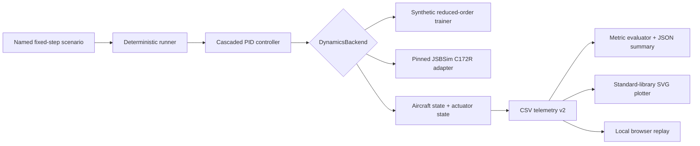

# Architecture

The numerical path is single-threaded. Telemetry is exported every five 10 ms integration steps (20 Hz); the simulation itself runs at 100 Hz. Rendering and file playback never alter simulation time.

`DynamicsBackend` is the boundary between FlightLab’s scenario/control code and a model implementation. The synthetic trainer exists for an educational, inspectable controller experiment. The JSBSim adapter is a separate open-loop reference path with a real, pinned flight-dynamics model; it does not yet run FlightLab’s controller.
